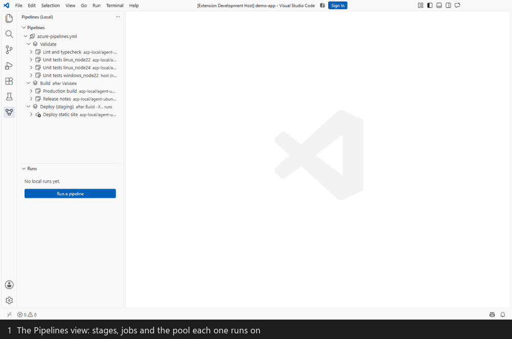
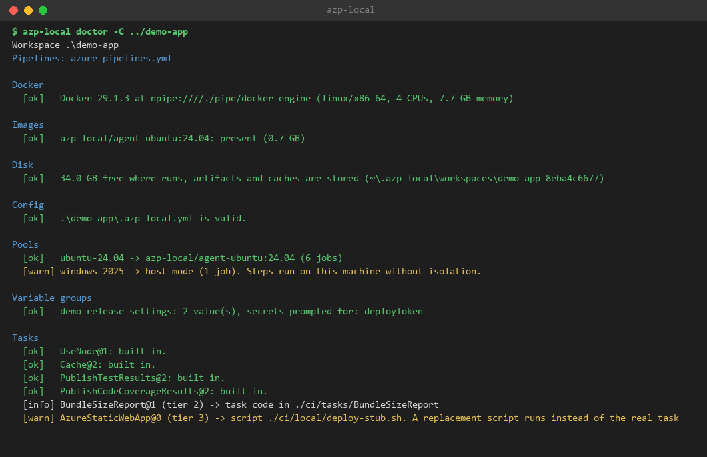
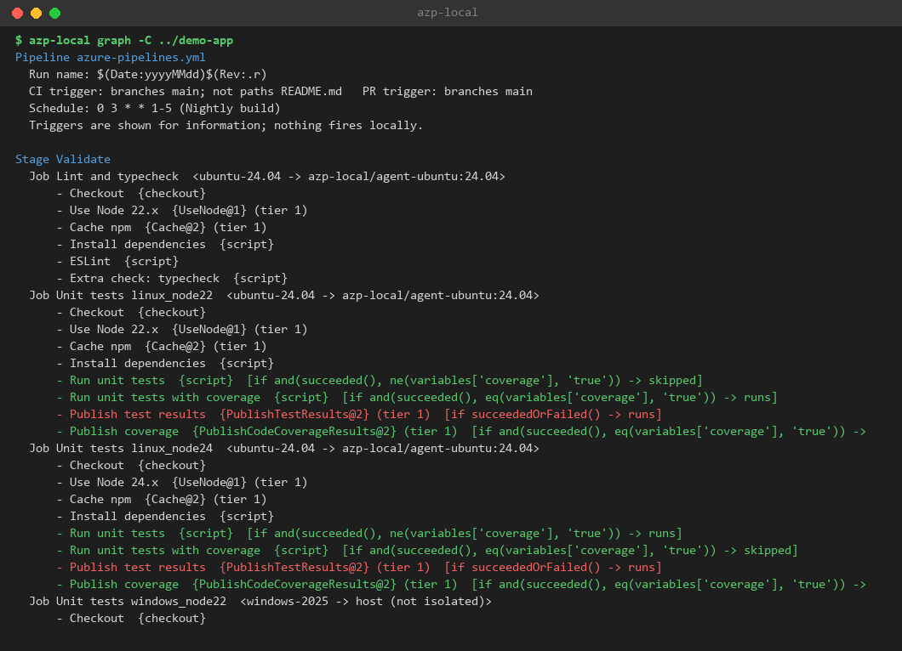
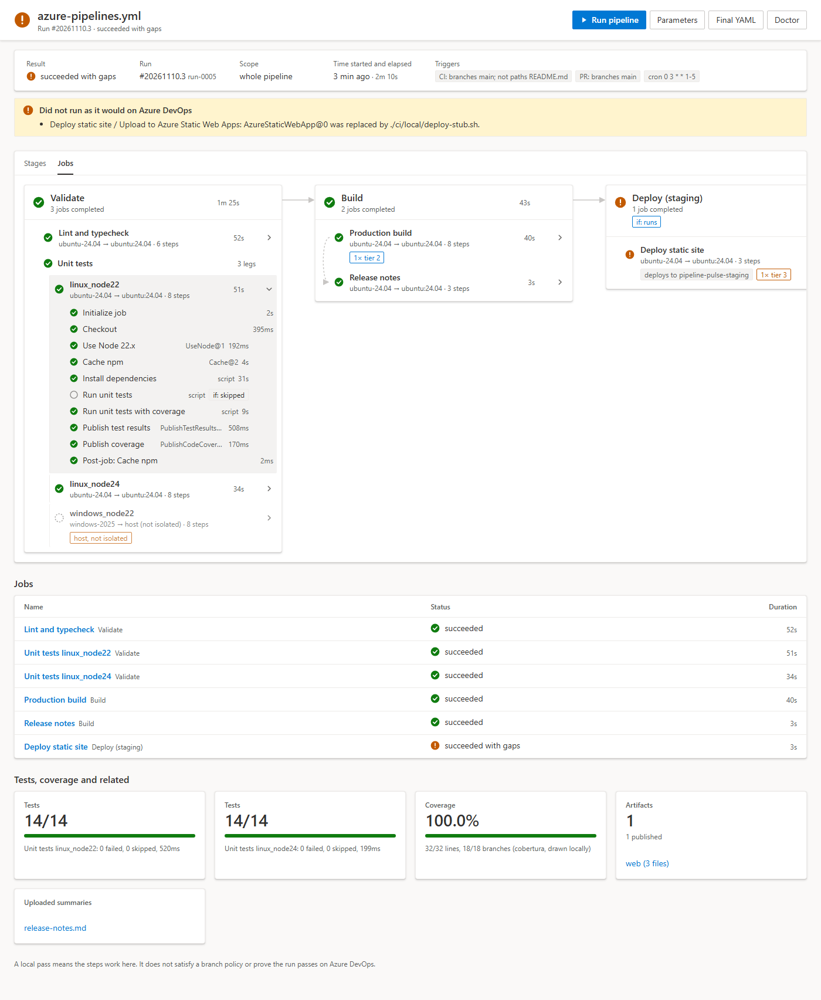
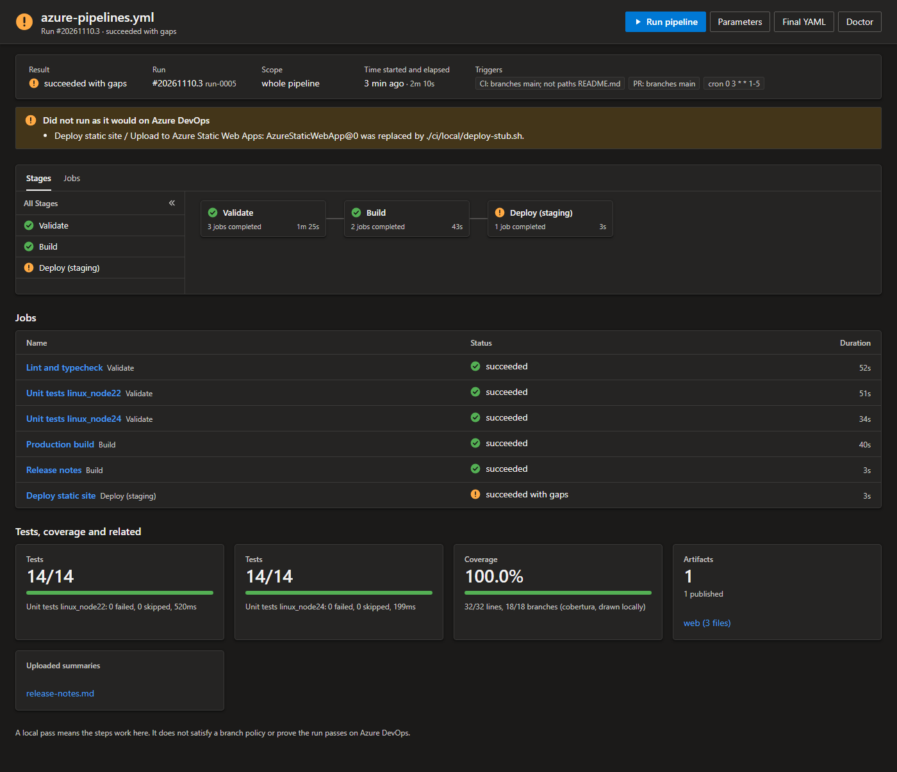
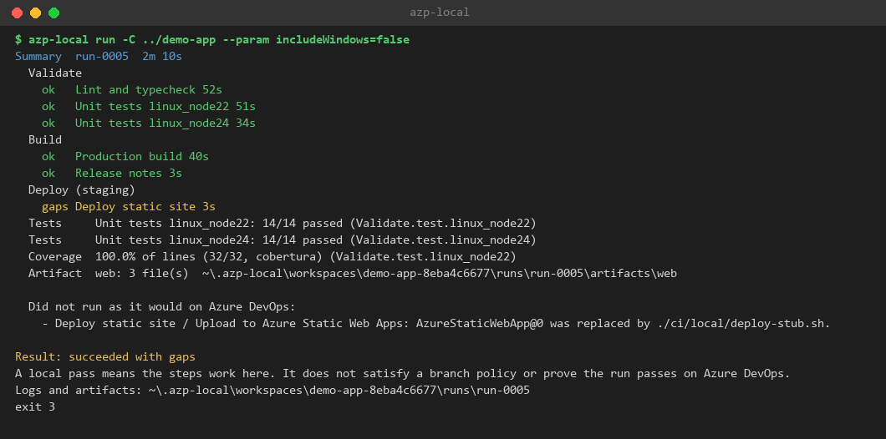

<div align="center">

# azp-local: Azure Pipelines, on your machine

### See your pipeline the way the Azure DevOps portal draws it. Run its jobs locally, before you push.

**Stop committing "try again" to find out why a pipeline failed.**

[](azp-local/LICENSE)
[](#quick-start)
[](#quick-start)
[](#requirements)

[Quick start](#quick-start) · [See it running](#see-it-running) · [How it works](#how-it-works) · [What it supports](#what-it-supports) · [Command line](#command-line) · [Your own repository](#use-it-on-your-own-repository) · [Status](#status) · [FAQ](#faq)

<br />



<sub>The whole demo pipeline running in containers from the command line. Replayed from the tool's real log; the image build is already cached.</sub>

</div>

---

Azure Pipelines YAML is hard to get right without running it, and the only place that runs it is Azure DevOps. A typo in a template, a wrong `dependsOn`, or a `condition:` that is always false costs a commit, a queue wait and a failed run.

**azp-local** reads any Azure Pipelines YAML file, expands its templates, draws the stages, jobs and steps as the portal does, and runs the jobs on your machine: one Docker container per job, one `exec` per step. It tells you plainly what it could not do locally, so a local pass is never mistaken for more than it is.

It is one core library with two front ends: a **VS Code extension** and an **`azp-local` command line**. No Azure DevOps account is needed.

| Folder | What it is |
| --- | --- |
| [`azp-local/`](azp-local) | The tool: core library, local Docker engine, `azp-local` command line and the VS Code extension |
| [`demo-app/`](demo-app) | A sample React frontend with an ordinary `azure-pipelines.yml`, used to try the tool |
| [`local-azure-pipelines-runner-design.md`](local-azure-pipelines-runner-design.md) | The analysis and design |
| [`SETUP.md`](SETUP.md) | Step-by-step build, install and first-run guide |

`azp-local` is generic and contains nothing about the demo. The only link is that its tests use the demo's pipeline as the first entry of their corpus.

## Quick start

### Requirements

| Tool | Version | Needed for |
| --- | --- | --- |
| Node.js and npm | 22.13 or newer | Building the tool and the command line |
| VS Code | 1.96 or newer | The extension |
| A Docker engine | Any recent | Running Linux jobs. Not needed to draw a pipeline, expand it, or run Doctor |
| Git for Windows | Any recent | `bash:` steps in Windows host mode |

Docker can be Docker Desktop, Rancher Desktop with the **dockerd (moby)** engine, or Podman with its Docker-compatible socket. On Windows it needs WSL 2.

### Build it

```bash
cd azp-local
npm install
npm run build
```

### Try it on the demo app

```bash
node packages/cli/bin/azp-local.cjs graph -C ../demo-app
```

```bash
node packages/cli/bin/azp-local.cjs doctor -C ../demo-app
```

```bash
node packages/cli/bin/azp-local.cjs run -C ../demo-app --param includeWindows=false
```

The first `run` builds the agent image (`azp-local/agent-ubuntu:24.04`), which takes a few minutes and needs internet access. Later runs reuse it. The first two commands need no Docker.

### Install the VS Code extension

```bash
npm run package
code --install-extension packages/vscode/azp-local-0.1.0.vsix --force
code ../demo-app
```

Trust the folder when VS Code asks (running a pipeline executes code from the repository), then click the **Pipelines (local)** icon in the activity bar. Or press **F5** in the `azp-local` folder to try the extension without installing it.

The full walk-through, with what you should see at each step, is in [`SETUP.md`](SETUP.md).

## See it running

Everything below is from a real run of the demo pipeline in Docker containers on Windows 10: six jobs across three stages, 14 of 14 tests passing on two Node versions, 100% line coverage, and one published artifact.

### Check your setup with Doctor

Doctor lists every pool, variable group and task that needs a decision, before you run anything.



The warnings are expected: they describe decisions the demo's `.azp-local.yml` already makes.

### See the pipeline before it runs

`graph` shows stages, jobs and steps with every expression already evaluated. The `[if ... -> skipped]` notes show which steps will not run for each matrix leg, and why.



### Run it, and read the result

The pipeline graph in VS Code after a full run. Each job shows its result and duration. Open a job to see its steps, then the test, coverage, artifact and summary tiles underneath.



The panel also follows the VS Code theme:



### The summary, in a terminal



The run ends as **succeeded with gaps**, and the exit status is `3`. That is intended: `AzureStaticWebApp@0` cannot run locally, so the demo's `.azp-local.yml` replaces it with a script that only checks the artifact. The tool never reports that as a plain pass.

> The graph screenshots are the extension's graph panel rendered from the stored data of that same run. The VS Code tree views, CodeLens and Problems panel are not pictured.

## How it works

```
                          azure-pipelines.yml  (+ templates, extends, other repos)
                                      │
                    ┌─────────────────▼──────────────────┐
                    │  core: parse, expand, plan         │   no VS Code import
                    │  expressions · templates · matrix  │
                    └───────┬──────────────────┬─────────┘
                            │                  │
              ┌─────────────▼───────┐   ┌──────▼───────────────┐
              │  CLI  azp-local     │   │  VS Code extension   │
              │  graph expand run   │   │  tree · graph · logs │
              │  doctor runs        │   │  CodeLens · Problems │
              └─────────────┬───────┘   └──────┬───────────────┘
                            └────────┬─────────┘
                          ┌──────────▼───────────┐
                          │ engine-local         │
                          │ container per job    │
                          │ exec per step        │
                          └──────────────────────┘
```

1. **Read and expand.** Shorthand forms, templates for stages, jobs, steps and variables, `extends`, templates from other repositories, matrix and `parallel` are expanded. Every element keeps its source position through expansion, so a problem is reported on the line that causes it.
2. **Plan.** Pick the whole pipeline, one stage, "from here", one job, or one step and those before it. Results of earlier runs can be reused.
3. **Run.** Each job gets a container; each step is an `exec` in it. Logging commands, step controls, output variables across jobs and stages, artifacts, caches, service containers, timeouts and retries are handled.
4. **Report.** Logs, tests, coverage and artifacts per run, plus a list headed *Did not run as it would on Azure DevOps*.

```
packages/
  core/          model, expressions, template expansion, planner, engine contract, run store
  engine-local/  Docker Engine API client, job backends, step runner, logging commands, built-in tasks
  cli/           azp-local: graph, expand, run, doctor, runs
  vscode/        the extension: tree views, graph webview, logs, CodeLens, diagnostics, tasks
  images/        Dockerfile of the slim ubuntu agent image
corpus/          pipelines from other ecosystems with their recorded expansions
```

## What it supports

| Area | What works |
| --- | --- |
| Pipeline model | Stages, jobs, deployment jobs (`runOnce`, `rolling`, `canary` flattened), `dependsOn`, conditions, `strategy` matrix and `parallel`, variables at every level, variable groups, parameters |
| Templates | Templates for stages, jobs, steps and variables, `extends`, templates from other repositories, `${{ if }}` / `elseif` / `else`, `each`, `insert` |
| Expressions | Literals, contexts, `a.b`, `a['b']`, `a.*.b`, the function table, status functions. Anything else is a diagnostic naming the construct |
| Tier 1 tasks | `script`, `bash`, `pwsh`, `powershell`, `checkout`, `download`, `publish`, `Cache@2`, `UseNode@1`, `NodeTool@0`, artifact tasks, `PublishTestResults@2` (JUnit), `PublishCodeCoverageResults` (Cobertura, lcov) |
| Tier 2 tasks | A task's own Node handler, from a folder mapped in `.azp-local.yml` |
| Tier 3 tasks | Cannot run locally. Drawn as such, replaced by a script you choose, and listed in the summary. The job is "succeeded with gaps" |
| Diagnostics | Errors and warnings on the line that causes them: missing templates, unknown `dependsOn`, dependency loops, invalid conditions, duplicate step names, misspelt keys |
| Run controls | Re-run failed, run a step and those before it, cancel, keep a failed container and open a shell in it |
| Secrets | Variable-group secrets from `AZP_SECRET_<NAME>`, a `--secrets` file outside the repository, or a prompt. In VS Code they are kept in the OS keychain |
| Safety | Workspace Trust is required to run. Any setting that weakens isolation (such as host mode) must be approved, in a terminal or with `--allow-unisolated` |

## Command line

```
azp-local graph  [file]            stages, jobs and steps, as text or --json
azp-local expand [file]            the YAML after template expansion
azp-local run    [file] [options]  --stage, --from-stage, --job, --step job:step, --rerun-failed
azp-local doctor                   Docker, images, disk, and what needs a decision
azp-local runs                     past local runs
```

| Option | Effect |
| --- | --- |
| `-C <dir>` | The repository to work on. Default: the current folder |
| `--stage <name>` / `--from-stage <name>` | Run one stage, or that stage and every later one |
| `--job <name>` | Run one job. `--job test.linux_node22` runs one matrix leg |
| `--step <job>:<step>` | Run a job up to and including a step |
| `--rerun-failed` | Run again what did not pass in the last run |
| `--param name=value`, `--var name=value` | Pipeline parameters and variables |
| `--yes` | Do not prompt |
| `--keep-on-failure` | Keep a failed job's container |

| Exit code | Meaning |
| --- | --- |
| `0` | Passed |
| `1` | Failed |
| `3` | Everything that ran passed, but something could not run locally (`--allow-gaps` makes this `0`) |
| `130` | Canceled |

## Use it on your own repository

1. Open the repository in VS Code and trust it. Any YAML file with top-level `stages`, `jobs`, `steps` or `extends` appears in the **Pipelines** view.
2. Run **Doctor**. It lists every pool, template repository, variable group and task that needs a decision.
3. Create `.azp-local.yml` in the repository root and answer those. Every key is optional:

```yaml
images:                    # pool or vmImage label -> container image, or "host"
  MyOnPremPool: ghcr.io/acme/onprem-agent:latest
repositories:              # resources.repositories alias -> local folder
  templates: ../shared-pipeline-templates
parameters:                # values for pipeline parameters
  environment: dev
variables:                 # variables and predefined-variable overrides
  Build.Reason: PullRequest
variableGroups:
  release-settings:
    region: westeurope
    apiKey: { secret: true }   # prompted for, kept in the keychain
tasks:                     # tasks that cannot run locally
  AzureWebApp@1: skip
  AzureCLI@2: { script: ./ci/local/azure-cli-stub.sh }
  MyCompanyTask@3: { path: ../tasks/MyCompanyTask }
```

4. Run **Doctor** again until nothing unexpected is left, then commit the file so teammates get the same local behaviour.

A pipeline that uses only `ubuntu-*` pools, script steps and the built-in tasks needs no `.azp-local.yml` at all.

Personal preferences are VS Code settings: search for `azpLocal` (`maxParallelJobs`, `keepContainersOnFailure`, `matchHostedHardware`, `dockerHost`, `codeLens`).

## Status

This is the first build, covering phases 1 to 3 of the design: see, run, widen. Phase 4, connecting to an Azure DevOps organisation, is not built.

| Verified | Not yet verified |
| --- | --- |
| Unit and engine tests (`npm test`), run in host mode with no Docker | **Expansion against Azure DevOps.** The recorded expansions in `corpus/expected` come from this expander. The design's oracle is the Preview API, which needs an organisation |
| Nine integration tests in a real VS Code (`npm run test:extension`) | **How the agent passes inputs to tasks** (`INPUT_<NAME>` variables, `##vso` commands) against a Microsoft task package. It is exercised with the demo's in-house task |
| The demo pipeline's Linux jobs in real containers: agent image built, six jobs run, 14/14 tests, 100% coverage, artifact published (Windows 10, Rancher Desktop with dockerd) | Runs on macOS and Linux hosts, and on Docker Desktop or Podman |
| The demo pipeline's Windows leg in host mode, end to end on Windows 10 | The extension used by hand across many repositories. So far it has been driven by its automated tests |

Known limits:

- `${{ variables.x }}` in a template expression sees pipeline-level and predefined variables, not stage- or job-level ones.
- A matrix computed at run time (`matrix: $[ ... ]`) is shown as a single leg.
- `PublishTestResults@2` reads JUnit only; other formats are reported as not run.
- Doctor does not yet list commands a pipeline calls that the image lacks.
- Reusing an earlier job result does not check whether the YAML changed since.
- Multi-root workspaces are handled per folder; one run at a time.

A local pass means the steps work on your machine. It does not satisfy a branch policy or prove the run passes on Azure DevOps.

## FAQ

<details>
<summary><strong>Do I need an Azure DevOps account?</strong></summary>

No. Nothing in this repository talks to Azure DevOps. Phase 4 would add that as an option.

</details>

<details>
<summary><strong>Do I need Docker?</strong></summary>

Only to run Linux jobs. Drawing the graph, expanding the YAML, Doctor and the diagnostics all work without it. Windows pools can be mapped to host mode.

</details>

<details>
<summary><strong>Why did my run stop with "weakens isolation"?</strong></summary>

Your `.azp-local.yml` maps a pool to `host`, so those jobs would run directly on your machine and could read and change your files. The file is part of the repository, so anyone who can change the repository can change it. Read the settings, then approve in a terminal, or pass `--allow-unisolated` if you trust them. To leave the host jobs out instead, switch them off with a pipeline parameter, as the demo does with `--param includeWindows=false`.

</details>

<details>
<summary><strong>Is a local pass a real pass?</strong></summary>

No, and the tool says so. It means the steps work here. Tasks replaced by scripts, host-mode legs and anything else that differs from Azure DevOps are listed under *Did not run as it would on Azure DevOps*, and the run ends as "succeeded with gaps".

</details>

<details>
<summary><strong>Where do runs, logs and caches go?</strong></summary>

In a per-repository folder under `.azp-local` in your home directory: runs, step logs, artifacts and caches. The **Runs** view lists past runs, and `azp-local runs` does the same from a terminal.

</details>

<details>
<summary><strong>The first run is slow.</strong></summary>

The first job builds the `azp-local/agent-ubuntu:24.04` image and downloads Node and your packages. On the machine used for the screenshots, the first full run of the demo took 8 minutes 54 seconds, almost five of them in "Initialize job" building the image. The next run, with the image and npm cache in place, took 2 minutes 10 seconds.

</details>

## Documentation

- [`SETUP.md`](SETUP.md): build, install, first run, command line, your own repository, settings and troubleshooting.
- [`azp-local/README.md`](azp-local/README.md): layout, build and test commands, what is built against the design.
- [`demo-app/README.md`](demo-app/README.md): the sample application and what each part of its pipeline exercises.
- [`local-azure-pipelines-runner-design.md`](local-azure-pipelines-runner-design.md): the analysis and design.

## Contributing

```bash
cd azp-local
npm install
npm test
npm run test:extension
```

`npm test` runs the unit and engine tests (Vitest) and needs no Docker. `npm run test:extension` opens a real VS Code with a throwaway profile for about half a minute.

## License

[MIT](azp-local/LICENSE)
